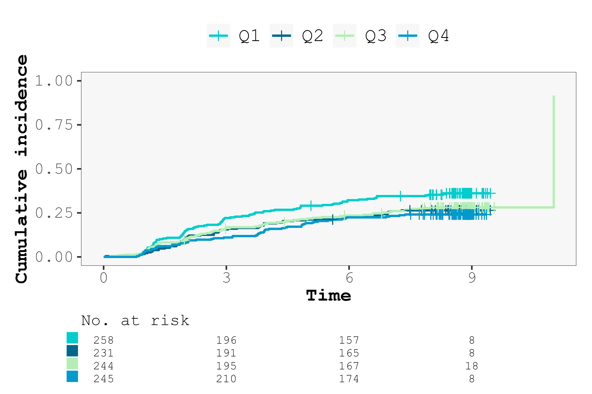

# Gallery

This gallery illustrates how to customize Kaplan–Meier survival curves
and Aalen–Johansen cumulative incidence curves with
[`cifplot()`](https://gestimation.github.io/cifmodeling/reference/cifplot.md)
and
[`cifpanel()`](https://gestimation.github.io/cifmodeling/reference/cifpanel.md).
Each example focuses on selected display options. For a full analysis
workflow, see [Worked
examples](https://gestimation.github.io/cifmodeling/articles/v5_examples.md);
for tables and reports, see [Reporting
results](https://gestimation.github.io/cifmodeling/articles/v7_reporting_results.md).

**Using this gallery.** The figures are saved images; their code chunks
are not executed when the vignette is built. To reproduce a figure, run
the setup chunk and its example in R. Some examples reuse objects
created earlier. Interpret the tails of curves cautiously when few
observations remain at risk; check the risk table before drawing
conclusions about late changes.

``` r

library(cifmodeling)
data("diabetes.complications", package = "cifmodeling")
gallery_data <- diabetes.complications

# Survival endpoint: first occurrence of either complication
gallery_data$d <- as.integer(gallery_data$epsilon > 0)

# Two fruit-intake groups for most figures
gallery_data$fruitq1 <- ifelse(
  gallery_data$fruitq == "Q1", "Q1", "Q2 to Q4"
)
set.seed(1)
```

In this dataset, `epsilon = 1` denotes diabetic retinopathy,
`epsilon = 2` denotes a macrovascular complication, and `epsilon = 0`
denotes censoring. For survival plots, `d = 1` indicates the first
occurrence of *either* complication. Unless noted otherwise,
competing-risk plots show the event-1 CIF.

## 1. Start with the default curves

With `outcome.type = "survival"`,
[`cifplot()`](https://gestimation.github.io/cifmodeling/reference/cifplot.md)
displays Kaplan–Meier survival probabilities, including a risk table and
censoring marks by default.

``` r

cifplot(Event(t,d) ~ fruitq1,
        data                    = gallery_data,
        outcome.type            = "survival")
```


Default Kaplan–Meier survival curves by fruit-intake group

With `outcome.type = "competing-risk"`,
[`cifplot()`](https://gestimation.github.io/cifmodeling/reference/cifplot.md)
instead displays the **cumulative incidence** of the selected event.

``` r

cifplot(Event(t,epsilon) ~ fruitq1,
        data                    = gallery_data,
        outcome.type            = "competing-risk")
```


Default cumulative incidence curves for diabetic retinopathy

## 2. Show or hide information in the plot

Set the following three options to `FALSE` to hide the shaded pointwise
confidence-interval ribbons, the risk table, and censoring marks. This
simplifies the display but removes information about uncertainty and
follow-up.

``` r

cifplot(Event(t,epsilon) ~ fruitq1,
        data                    = gallery_data,
        outcome.type            = "competing-risk",
        add.conf                = FALSE, 
        add.risktable           = FALSE, 
        add.censor.mark         = FALSE)
```


Cumulative incidence curves without pointwise confidence-interval
ribbons, risk table, or censoring marks

Use `add.estimate.table = TRUE` to show CIF estimates and confidence
intervals at selected times. Set `add.competing.risk.mark = TRUE` to
mark competing events on the event-1 plot.

``` r

cifplot(Event(t,epsilon) ~ fruitq1,
        data                    = gallery_data,
        outcome.type            = "competing-risk",
        add.risktable           = FALSE, 
        add.estimate.table      = TRUE, 
        add.censor.mark         = FALSE, 
        add.competing.risk.mark = TRUE)
```


Cumulative incidence with an estimate table and competing-event marks

Alternatively,
[`extract_time_to_event()`](https://gestimation.github.io/cifmodeling/reference/extract_time_to_event.md)
returns event-2 times as a named list. Pass that list to
`competing.risk.time` when event times are prepared separately. With
this dataset, the displayed figure is the same as in the preceding
example.

``` r

# Extract event-2 time from data frame
time_to_event <- extract_time_to_event(Event(t, epsilon) ~ fruitq1,
                                       data = gallery_data,
                                       which.event = "event2")

# Ensure named list by strata
stopifnot(is.list(time_to_event), length(time_to_event) > 0)

# Add event-2 time marks using external event-2 time 
cifplot(Event(t, epsilon) ~ fruitq1,
        data                    = gallery_data,
        outcome.type            = "competing-risk",
        add.risktable           = FALSE,
        add.estimate.table      = TRUE,
        add.censor.mark         = FALSE,
        add.competing.risk.mark = TRUE,
        competing.risk.time     = time_to_event)
```

The next example changes the competing-event marks to larger open
circles. Although `add.risktable = FALSE` hides the number-at-risk
table, `add.estimate.table = TRUE` keeps the estimate table visible.
`symbol.risk.table = "circle"` adds group symbols to that estimate
table.

``` r

cifplot(Event(t, epsilon) ~ fruitq1,
        data                      = gallery_data,
        outcome.type              = "competing-risk",
        add.risktable             = FALSE,
        add.estimate.table        = TRUE,
        symbol.risk.table         = "circle", 
        add.censor.mark           = FALSE,
        add.competing.risk.mark   = TRUE,
        shape.competing.risk.mark = 1,
        size.competing.risk.mark  = 4,
        competing.risk.time       = time_to_event)
```


Open-circle marks for competing events and circle symbols in the
estimate table

## 3. Annotate an estimated effect

[`effect_label.polyreg()`](https://gestimation.github.io/cifmodeling/reference/polyreg-methods.md)
formats an estimate from
[`polyreg()`](https://gestimation.github.io/cifmodeling/reference/polyreg.md)
for use as a plot annotation. Add it with
[`ggplot2::annotate()`](https://ggplot2.tidyverse.org/reference/annotate.html).
Here the eight-year RR compares Q2–Q4 with Q1 as the reference group—the
**reverse comparison** of the Q1-versus-Q2–Q4 RRs in [Direct polytomous
regression](https://gestimation.github.io/cifmodeling/articles/v2_polyreg.md)
and [Worked
examples](https://gestimation.github.io/cifmodeling/articles/v5_examples.md).
For the same event, time, and population, reversing the comparison gives
the reciprocal RR. The annotation comes from the fitted regression
model, **not** from visual inspection of the curves.

``` r

# Fit direct polytomous regression
output1 <- polyreg(nuisance.model=Event(t,epsilon)~1, exposure="fruitq1", code.exposure.ref="Q1",
          data=gallery_data, effect.measure1="RR", effect.measure2="RR",
          time.point=8, outcome.type="competing-risk")

# Create a label of the risk ratio of event1
output2 <- effect_label.polyreg(output1, 
                              event="event1",
                              add.exposure.levels=FALSE, 
                              add.outcome=FALSE, 
                              add.conf=FALSE)
output3 <- cifplot(Event(t,epsilon) ~ fruitq1,
        data                    = gallery_data,
        outcome.type            = "competing-risk")

# Add the label
output4 <- output3$plot + ggplot2::annotate("text", x=6, y=0.8, 
                                            label=output2, hjust=1, vjust=1)
print(output4)
```


A fitted eight-year risk ratio added to a cumulative incidence plot

## 4. Arrange multiple panels

With `panel.per.variable = TRUE`,
[`cifplot()`](https://gestimation.github.io/cifmodeling/reference/cifplot.md)
creates a panel for each grouping variable in the formula.

``` r

cifplot(Event(t,epsilon) ~ fruitq + fruitq1,
        data                      = gallery_data,
        outcome.type              = "competing-risk",
        panel.per.variable        = TRUE)
```


Two panels comparing fruit-intake groupings

With `panel.per.event = TRUE`,
[`cifplot()`](https://gestimation.github.io/cifmodeling/reference/cifplot.md)
displays each competing event in a separate panel.

``` r

cifplot(Event(t,epsilon) ~ fruitq1,
        data                      = gallery_data,
        outcome.type              = "competing-risk",
        panel.per.event           = TRUE)
```


Separate cumulative incidence panels for retinopathy and macrovascular
complications

For survival outcomes, `panel.censoring = TRUE` adds the censoring
distribution alongside the event-free survival curves.

``` r

cifplot(Event(t,d) ~ fruitq1,
        data                      = gallery_data,
        outcome.type              = "survival",
        panel.censoring           = TRUE)
```


Panels for event-free survival and censoring

## 5. Add a zoomed-in view

When cumulative incidence is low, a narrower vertical scale can make
differences easier to see. In
[`cifpanel()`](https://gestimation.github.io/cifmodeling/reference/cifpanel.md),
`inset.panel = TRUE` places the zoomed view inside the main plot. Each
`code.events` entry specifies the event of interest, competing event,
and censoring code, in that order. Both views below use event 2 as the
event of interest.

``` r

output5 <- cifpanel(
 title.plot = c("Fruit intake and macrovascular complications", "Zoomed-in view"),
 inset.panel           = TRUE,
 formula               = Event(t, epsilon) ~ fruitq,
 data                  = diabetes.complications,
 outcome.type          = "competing-risk",
 code.events           = list(c(2,1,0), c(2,1,0)),
 label.y               = c("CIF of macrovascular complications", ""),
 label.x               = c("Years from registration", ""),
 limits.y              = list(c(0,1), c(0,0.15)),
 inset.left            = 0.40, 
 inset.bottom          = 0.45,
 inset.right           = 1.00, 
 inset.top             = 0.95,
 inset.legend.position = "none",
 legend.position       = "bottom", 
 add.conf              = FALSE
)
print(output5)
```


An inset panel zooming into the macrovascular complication CIF

## 6. Customize fonts, styles, and palettes

Adjust `font.size` and `font.size.risk.table` to change text sizes in
the plot and risk table. Labels, styles, and palettes change the
presentation without changing the estimated curves.

``` r

cifplot(Event(t,epsilon) ~ fruitq,
        data                      = gallery_data,
        outcome.type              = "competing-risk",
        add.conf                  = FALSE, 
        font.size                 = 16, 
        font.size.risk.table      = 3)
```


Larger curve labels with a compact risk table

The next code block applies four built-in styles to the same four-group
CIF plot. The saved figures appear in the same order.

``` r

cifplot(Event(t,epsilon) ~ fruitq,
        data                      = gallery_data,
        outcome.type              = "competing-risk",
        add.conf                  = FALSE, 
        style                     = "bold", 
        font.family               = "serif", 
        palette                   = c("blue1", "cyan3", "navy", "deepskyblue3"))
cifplot(Event(t,epsilon) ~ fruitq,
        data                      = gallery_data,
        outcome.type              = "competing-risk",
        add.conf = FALSE, 
        style                     = "framed", 
        font.family               = "serif", 
        linewidth                 = 1.3, 
        linetype                  = TRUE, 
        palette                   = c("azure4", "gray", "black", "darkgray"))
cifplot(Event(t,epsilon) ~ fruitq,
        data                      = gallery_data,
        outcome.type              = "competing-risk",
        add.conf                  = FALSE, 
        style                     = "gray", 
        font.family               = "mono", 
        palette                   = c("cyan3", "deepskyblue4", "darkseagreen2", "deepskyblue3"))
cifplot(Event(t,epsilon) ~ fruitq,
        data                      = gallery_data,
        outcome.type              = "competing-risk",
        add.conf                  = FALSE, 
        style                     = "ggsurvfit", 
        font.family               = "mono", 
        palette                   = c("brown", "orange", "purple", "darkgoldenrod"))
```


Bold style with serif font and blue palette


Framed style with serif font, line types, and grayscale palette



Gray style with monospace font

 \## 7. Change labels and axes

Use `label.strata` for legend labels, `level.strata` to associate those
labels with group values, and `order.strata` to control display order.
Explicit mappings avoid dependence on alphabetical ordering.

``` r

cifplot(Event(t,d) ~ fruitq1,
        data                      = gallery_data,
        outcome.type              = "survival",
        label.y                   = "Survival (no complications)",
        label.x                   = "Years from registration",
        label.strata              = c("High intake","Low intake"), 
        level.strata              = c("Q2 to Q4","Q1"), 
        order.strata              = c("Q1", "Q2 to Q4"))
```


Kaplan–Meier curves with custom group labels and legend order

Set `type.y = "risk"` to show the composite-event probability rather
than event-free survival. Use the axis arguments to set the displayed
range and tick marks.

``` r

cifplot(Event(t,d) ~ fruitq1,
        data                      = gallery_data,
        outcome.type              = "survival",
        label.y                   = "Risk of diabetes complications",
        label.x                   = "Years from registration",
        label.strata              = c("High intake","Low intake"), 
        level.strata              = c("Q2 to Q4","Q1"), 
        order.strata              = c("Q1", "Q2 to Q4"),
        type.y                    = "risk",
        limits.y                  = c(0, 0.5),
        breaks.y                  = seq(0, 0.5, by=0.1),
        limits.x                  = c(0, 8),
        breaks.x                  = 0:8,
        use.coord.cartesian       = TRUE) 
```


Composite-event risk curve with customized axis ranges and ticks

## 8. Use a complementary log–log scale

For survival outcomes, `type.y = "cloglog"` uses a complementary log–log
**plotting scale**, not the `conf.type = "log-log"` CI transformation.
Roughly parallel curves may be consistent with proportional hazards, but
this display is **not a formal test**. Interpret the plot cautiously
when few subjects remain at risk.

``` r

cifplot(Event(t,d) ~ fruitq1,
        data                      = gallery_data,
        outcome.type              = "survival",
        type.y                    = "cloglog")
```


Complementary log–log display of survival curves

## Further reading

- [Worked
  examples](https://gestimation.github.io/cifmodeling/articles/v5_examples.md)
  shows a complete estimation–testing–regression workflow.
- [Computational
  formulas](https://gestimation.github.io/cifmodeling/articles/v4_formulas.md)
  explains estimates, standard errors, and confidence intervals.
- [Reporting
  results](https://gestimation.github.io/cifmodeling/articles/v7_reporting_results.md)
  shows how to create tables and reports from fitted objects.
- [Function
  reference](https://gestimation.github.io/cifmodeling/articles/v9_arguments.md)
  lists available arguments and defaults.
